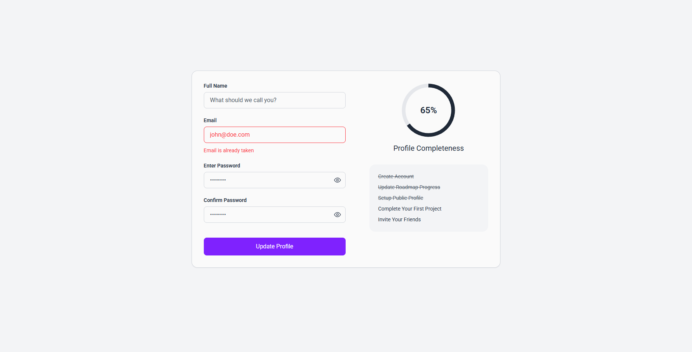

# Accessible Form UI

A responsive and accessible profile form UI built with **HTML and CSS** as part of the [roadmap.sh Accessible Form UI challenge](https://roadmap.sh/projects/accessible-form-ui).

The project focuses on creating a clean form interface with accessibility features such as semantic labels, ARIA attributes, validation states, and keyboard-friendly focus styles.

## ✨ Features

- Profile update form
- Email error state
- Password and confirm password fields
- Password visibility controls
- Profile completeness indicator
- Accessibility-focused HTML attributes
- Responsive layout

## 🛠️ Technologies

- HTML5
- CSS3

## 🖼️ Preview

## 📚 Challenge

[Accessible Form UI — roadmap.sh](https://roadmap.sh/projects/accessible-form-ui)

## 📌 Status

**Completed**
